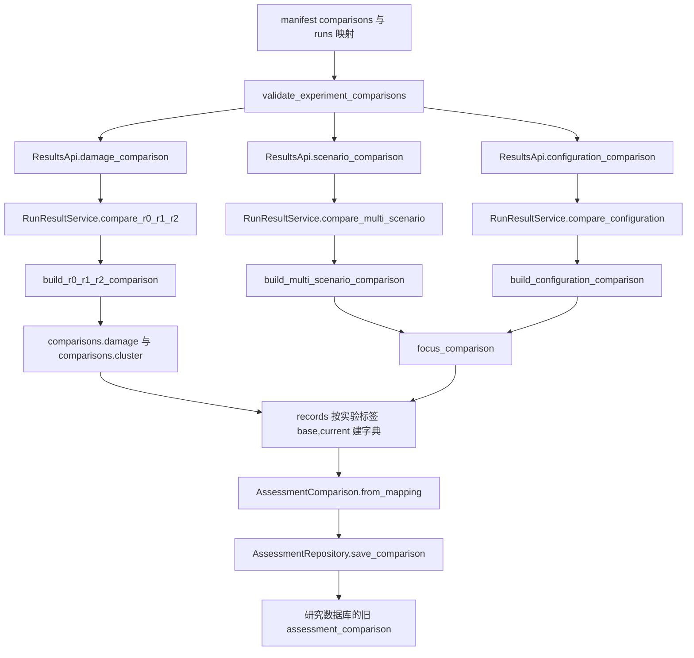
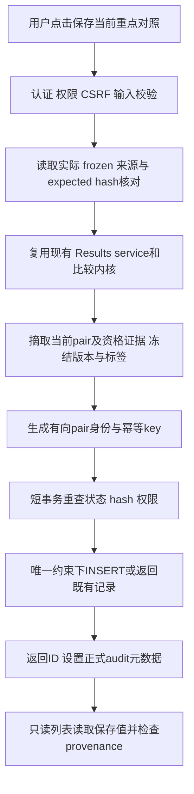

# 2B 第一阶段：assessment_comparison 语义与生产链设计审计

日期：2026-10-08（北京时间）。

状态：现状审计完成；下文的正式产品模型、权限和操作范围为**唯一推荐设计，待文末三项人工确认**。本文件不代表已执行 migration 或已上线保存功能。

## 1. 执行摘要

1. **旧 AssessmentComparison 是“机场／场景评估比较记录”的通用文本容器，不能作为目前 Run 级严格比较的正式模型。** 字段没有 Run 外键、双方 hash、比较规则版本、用户身份或 stale 判断。测试用机场与强度级别表达比较；研究脚本把 Run 实验标签塞进 scenario_type，二者不是同一业务语义。
2. 正式页面三个比较工作区已经有明确的有向 focus pair：损毁页为当前 R0→R1 或 R1→R2，多损毁与方案配置页为明确 baseline→comparison。多损毁同时具有全组选定 Run 的总览事实和结论，不能把全组结论伪装成 pair 结论。
3. **推荐方案 A：一次保存只冻结当前 focus pair 的正式事实。** 损毁页只保存当前阶段；多损毁与配置页只保存当前重点对照。不批量保存全部阶段／全部 pair，不保存整个分析会话。此保存范围必须由用户确认，因为当前产品尚无保存操作，代码无法证明用户未来的保存意图。
4. 区域名称推荐 **“结果比较记录”**。“跨场景”不能覆盖同一损毁下的组群调整、同条件配置变化；“评估比较”又容易与四项正式指标综合评价混淆。
5. 旧表语义不适合。**唯一推荐 migration 方案 2：在正式旧表为空这一前提下，重建／替换 assessment_comparison 为 Run pair 记录表。** 不扩展为大量机场字段与 Run 字段共存的混合表，不引入 member／session 表。
6. 正式链路为用户显式保存 → 服务端重读 frozen 来源、校验权限／严格规则／预期 hash → 调用现有比较内核 → 冻结 pair 事实 → 原子幂等插入 → 只读列表展示。Worker、容量 projection、综合评价生产链不参与。
7. 严格输入可比与 J 定义可比是不同条件。合法配置比较中 J 可能不可直接比较；仍可保存其合法业务事实与不可比标记，严禁生成非法 J 差值或优劣结论。

### 审计范围与证据边界

- 基线 HEAD：`84ee66f7a9ac398f1d634d80a0c8a84d0e036ca9`。审计针对保留 2A／2A-R1 的**当前工作树**，不是仅针对 HEAD。
- 正式 `assessment_comparison=0`、2A canonical／容量／指标链通过验收，是本任务接受的冻结事实；参考 `runtime/acceptance/assessment-2a-r1-20261008/report.md` 与 `facts-after-idempotence.json`。本阶段没有重新打开正式数据库验证这些事实。
- 操作路径依据真实模板、事件监听器、API／service／kernel 和既有测试断言恢复；未登录、点击运行服务或调用比较 HTTP API，避免本阶段产生新的审计写入。不把静态审计表述为本轮真实浏览器验收。
- 已对 tests 全目录搜索 `AssessmentComparison|save_comparison|list_comparisons|comparison|damage|multi|configuration`，命中 61 个文件；追踪直接比较调用及有关权限、导出、migration、2A 不变量测试。宽泛关键词命中也包含损毁编辑、底图等旁支，未将它们认作 comparison 生产入口。
- 仅生成本报告；未运行产品、实验脚本、测试、migration、backfill、数据库复制或写入复现。SQLite I/O 保留为独立已知问题，本阶段不诊断、不修复。

## 2. 现有 AssessmentComparison 的真实语义

依据 `backend/domain/assessment.py:186`、`backend/storage/migrations/v021_assessment_visualization.py:28`、`tests/web/test_assessment_results_api.py:104` 与前端 `assessmentComparisonLabel()`：

- 模型表达的是两个可选“机场＋场景类型”描述端点，再附一段结论和 log。所有四个端点字段均可为空，甚至不强制存在任何一端。因此不能说它已严格定义了“两机场”“两场景”或“两 Run”。
- 最早可观察的设计表达偏向机场评估比较：测试种子为 AP1／medium 对 AP2／high，结论“二号机场恢复较慢”。这是**测试数据**，不是已存在的正式业务历史。
- 前端按机场名、场景强度标签渲染，说明当前展示也沿用机场评估端点表达。
- 未找到正式业务创建 API、页面保存按钮或服务生产者。正式路径只有读取；找到的写入调用是 V5 研究脚本和测试种子。
- 原始作者的主观意图没有进一步证据；以上结论来自现存结构和调用，不把推测写成作者已作出的产品决策。

## 3. 当前 schema 字段及实际使用情况

旧表只有以下八列；除 `id`、`created_at` 外可为 NULL，四个端点字段没有外键。

| 字段 | 当前定义与约束 | 实际赋值／使用 | 对正式 Run 比较的缺口 |
|---|---|---|---|
| `id` | TEXT PRIMARY KEY | 测试 CMP-1；实验 `v5cmp:{base}:{current}` | 实验身份只含标签 pair，不含 mode／hash／用户 |
| `base_airport_id` | TEXT，可空 | 测试 AP1；V5 不赋值；没有正式生产者 | 不是运行实例身份 |
| `base_scenario_type` | TEXT，可空 | 测试 medium；V5 R0／P0 等实验 Run 标签 | 不是统一的 scenario ID，更不是正式 Run ID 字段 |
| `compared_airport_id` | TEXT，可空 | 测试 AP2；V5 不赋值；没有正式生产者 | 同上 |
| `compared_scenario_type` | TEXT，可空 | 测试 high；V5 R1／RESOURCE 等标签 | 同上 |
| `conclusion` | TEXT，可空 | 测试直接提供；V5 从 focus values 自动生成文本 | 没有正式人工输入 UI，也没有正式结论规则版本 |
| `log` | TEXT，可空 | 测试任意文本；V5 JSON 字符串 `{mode, focus_comparison}` | schema／domain 不验证其 JSON 结构；API 原样返回字符串，UI 只放在 title |
| `created_at` | TEXT NOT NULL，默认 `datetime('now')` | repository 可接受传入值；upsert 可改写时间 | 旧接口不是不可变历史记录 |

逐项补充：

- **正式机场赋值：没有发现。** 当前正式表为空；测试种子赋值不能证明正式业务使用。
- **Run ID：没有专用字段。** V5 的 log 内嵌 focus 中有 `baseline_run_id`、`comparison_run_id`，因此不能说实验记录完全没有 Run ID；但不是受约束、可索引、可校验的正式 provenance。
- **Snapshot／Metrics hash：旧 comparison 不保存。** 即使 manifest 另有 hash，也没有写入 comparison 记录形成来源闭环。
- **calculation version、created_by、stale：全部缺失。** 内核返回的 `comparison.v1` 是 payload 结构版本，不等于旧 comparison 已存算法版本；V5 log 也未保存完整外层 payload。
- `AssessmentRepository.save_comparison()`（242）按 id upsert，覆盖全部内容及 created_at；没有“相同来源返回旧记录”的幂等定义。
- `list_comparisons()`（272）按时间／id 排序并提供 repository 级 limit／offset，但无 owner 条件。`AssessmentResultsApi.comparisons()`（171）只有 `results.read` 和 limit，API 未开放 offset。

### assessment 相关 migration 的边界

| migration | 作用 | 是否完善旧 comparison |
|---|---|---|
| v021_assessment_visualization | 创建 capacity 前身、机场风险、旧 comparison | 创建旧八字段表 |
| v023_assessment_run_provenance | 为 `assessment_result` 添加 metric_kind、matrix_value、source_run_id、双 hash、窗口计数等 | 否；仅容量结果 |
| v024_indicator_assessment | 指标分类／计算类型、正式权重配置和四指标集 | 否 |
| v025_run_indicator_evaluation | Run 评价和指标值，含 provenance、calculation_version、风险状态 | 否 |

已搜索全部 migration 中的 `assessment_` 引用。v022 是 security／backup／audit_report，v026 是库存契约修复，没有把 comparison 改为 Run 模型。不能借用容量或评价表的字段来声称 comparison provenance 已具备。

## 4. V5 comparison 的真实生成链

### 4.1 manifest 明确指定的 Run

`resources/experiments/jiangsu_six_airport_v5.json:140` 指定以下标签，脚本通过 `definition.runs` 映射到 Run ID：

| 组 | 标签 → Run ID | 实际比较 |
|---|---|---|
| damage_and_cluster 第一组 | R0 → RUN-ROUND15-R0；R1 → RUN-ROUND15-R1；R2 → RUN-ROUND15-R2 | R0→R1、R1→R2 |
| damage_and_cluster 第二组 | P0 → RUN-ROUND18-P0；P1 → RUN-ROUND18-P1；P2 → RUN-ROUND18-P2 | P0→P1、P1→P2 |
| multi_damage | R0、R1、RESOURCE → RUN-ROUND16-RESOURCE、CAPACITY → RUN-ROUND16-CAPACITY、MUN2 → RUN-ROUND17-MUN2、STORAGE → RUN-ROUND17-STORAGE | 每次都传入上述六个 Run，固定 R0 为 baseline，依次以另外五个 Run 为 current |
| configuration 第一组 | R1、R2 | R1→R2 |
| configuration 第二组 | P1、P2 | P1→P2 |
| configuration 第三组 | P0、P3 → RUN-ROUND19-P3 | P0→P3 |

### 4.2 实际调用链



这里是直接调用 Python API adapter，principal 是 `Principal(definition.owner_user_id, is_admin=True)`，不是用户点击 HTTP 保存，也不经过 Flask after_request 审计。位置：`tools/dev_validation/rebuild_v5_experiment.py:657`。

### 4.3 输入、输出与落库

- 三个比较 service 都读取成功 Run 的 immutable Snapshot 和 canonical Metrics。普通比较内核输入为 `(RunSnapshot, Metrics)`，不重新运行求解器，也不读取当前情境来代替 Snapshot。Solution 属于成功结果完整性检查；这些 focus 比较不直接用 Solution 计算。
- damage 内核输出 roles、两个阶段 focus、任务／机场／机型／资源／协同事实、timeline、summary、solver facts 和结论。
- multi 输出六 Run 总览、extrema、分布结论，以及当前指定 pair 的 focus。
- configuration 输出显式基准下的各 Run 差值、重点 pair、配置差异和保守求解事实。
- 脚本中的 `base`、`current` 是实验标签；focus 内的 baseline／comparison 是真实 Run ID。它们不是机场 ID。`focus` 是有向重点 pair 的计算结果。
- damage 分别摘取两阶段；multi 五次摘取 focus；configuration 三次摘取 focus，均要求 eligible。
- `_comparison_conclusion()`（635）生成“履行／缺口／出动 baseline→current；J差值／J不可直接比较”，不是人工结论，也不是完整 payload 的两条结论。
- **log 保存完整 focus 对象的 JSON，不只是文本摘要。** 但它没有保存完整外层多 Run／三 Run payload：全组分布与 extrema、外层配置差异、所有 solver 对照、run_summaries 等并未整体写入；双方 hash、规则版本、创建用户也缺失。
- `persist_records=False` 时不写库；函数返回的 `persisted_records=len(records)` 仍是候选字典大小，不能仅凭该字段证明真的执行了插入。默认参数目前为 True。

### 4.4 多损毁是否保存了 multi-run 对象

**没有。** 每次 API 输入六个 Run，最后保存的是 R0→某一 current 的 pair focus。不会保存一个含六成员的 comparison 对象。

另有不能忽略的覆盖规则：字典键只有 `(base_label, current_label)`，不含 mode。执行顺序为 damage → multi → configuration。

- R0→R1 被 multi 覆盖；R1→R2 和 P1→P2 被 configuration 覆盖。
- 12 次 pair 候选最终变为 **9 个唯一标签 pair**：P0→P1 保留 damage 模式；R0→R1／RESOURCE／CAPACITY／MUN2／STORAGE 为 multi；R1→R2、P1→P2、P0→P3 为 configuration。
- 冻结 `jiangsu_six_airport_v5_result_index.json` 的 `persisted_records=9` 与代码吻合；测试也有研究 comparison=9 的断言。这是研究脚本的去重结果，不是正式产品应跨模式去重的依据。

实验关系及其旧 log 不能自动复制到正式库。

## 5. 三个正式结果工作区的比较模型

模板 `frontend/templates/pages/results.html:8`、JS `results.js:389,437,666,679` 与 `tests/frontend/test_results_frontend_contract.py:29` 共同确定以下路径。

| 问题 | A 损毁与组群 | B 多损毁 | C 方案配置 |
|---|---|---|---|
| 用户选几个 Run | 后端批准的三元组，恰好三个不同 Run | 2–6 个不同 Run | 2–5 个不同 Run |
| 基准／对照 | 固定 R0 无损毁未组群；R1 目标损毁未组群；R2 同损毁组群 | baseline 与 comparison 可在选定集合中显式切换，默认前两个不同 Run | baseline 必填；comparison 可切换，缺省取另一 Run |
| 当前 focus | activeDamageStage=damage 为 R0→R1；cluster 为 R1→R2 | payload.focus_comparison | payload.focus_comparison |
| 页面总体 | 三 Run 上下文、两阶段摘要、一个当前 pair | 多 Run 总览／多线趋势＋一个重点 pair；外层第一条结论含全组分布 | 多方案基准差值总览＋一个重点 pair；配置差异是当前 pair |
| 稳定事实 | 各阶段 values、timeline、component 可比标记、结构／保障及内核结论 | pair focus；选定全组的总览也是稳定计算结果，但属于另一保存粒度 | pair focus、pair 配置差异、求解事实；全组差值属于另一粒度 |
| UI 视角 | 当前阶段决定要保存哪一 pair；曲线类型、主题、滑块位置不落库 | focus 选择决定 pair 身份；图例 D0/D1、其余背景 Run、主题和视窗不属于 pair | focus 决定 pair 身份；“方案2”等临时序号、视窗不属于 pair |
| 推荐保存一级 | 当前阶段的 pair | 当前重点 pair | 当前重点 pair |

### 严格可比与 definition 可比

1. `RunResultService._successful_bundle()`（89）检查访问者、succeeded、Snapshot／canonical 结果存在及结果 Run ID。
2. 候选查询在 `list_damage_comparison_candidates()`（287）、`list_comparable_successful()`（223）；候选只帮助选择，保存时仍必须重新验证。
3. `comparison.py:292` 比较实际算法输入：基础机场／任务／OD／机型关系／资源及补充／有效时间范围。不是只比较情境 ID 或损毁显示名称；v5 历史 Snapshot 有专用只读投影，不改写 Snapshot。
4. `check_r0_r1_r2()`（403）校验固定角色、相同损毁实际输入以及锁定目标校准、求解预算／随机种子等。`check_multi_scenario_comparable()`（344）只允许 damage_scenario_id 改变；其他 run_config 均须一致。`check_configuration_comparable()`（357）允许业务配置变化，但锁定同一损毁实际条件、seed 和 time limit。
5. `_require_common_metrics_contract()`（726）检查 Metrics schema、slot_minutes、完整 windows 与时间序列一致。不可比抛 ComparisonError，经 `error_mapping.py` 返回 422 `RUNS_NOT_COMPARABLE`，没有尽力补零或静默降级。
6. `check_objective_comparable()`（389）和 `_component_comparability()`（971）另行判断 J／F1／F2／F3 的定义。配置变化可导致 J 不可比，而业务结果仍合法可比。
7. 不可比组件保留原始 baseline/current、`recorded`、`definition_comparable=false`、reasons，delta 为 null。前端 `displayValue()`、`renderValueComparison()` 区分未记录、0、不可直接比较。
8. **保存禁用条件是整体严格比较不合法；不能用 `J.definition_comparable=false` 直接禁用整个记录。** 缺失某个非必需组件也不能填零或虚构事实。

已有 `exploratory-comparison` 与 `object-comparison` API／内核，但正式页面没有它们的工作区，测试明确排除探索入口。本阶段正式记录不接入它们。对象比较还可能读取 Solution；不能将其混入当前 Snapshot＋Metrics 的 pair 保存模型。

## 6. “跨场景记录”名称是否准确

**不准确，推荐改为“结果比较记录”。**

- R1→R2 可以是同一损毁场景的组群开关变化。
- configuration 可以改变偏好／权重／核心机场等，而不改变损毁场景。
- multi 才可能同时具有不同损毁场景；相同条件不同 Run 也仍是不同运行实例。
- “比较记录”虽可用，但“结果比较记录”更能表达三个工作区的来源；“评估比较记录”容易使用户期待四指标能力指数／风险的差值。

仅对记录卡片标题、空态和保存反馈提出改名；不调整容量矩阵、综合评价、风险名称或其他视觉样式。本阶段未修改模板。

## 7. 正式 comparison 推荐产品语义

正式记录定义为：

> 一名有权限的用户，在某一种严格比较定义下，对两个有方向的成功 Run，使用其冻结 Snapshot 和 canonical Metrics，显式保存的一份不可变比较事实与结论。

推荐 `comparison_mode` 四个值，不另存冗余 workspace 列：

| comparison_mode | 来源 workspace | 明确定义 |
|---|---|---|
| `damage_effect` | damage 的损毁阶段 | R0→R1，current−base |
| `cluster_effect` | damage 的组群阶段 | R1→R2，current−base |
| `multi_scenario` | multi | 用户当前选定 baseline→comparison |
| `configuration` | configuration | 当前基准方案→对照方案 |

同一 pair 在 cluster_effect 与 configuration 中可以形成不同记录；二者的资格规则／语境不同。conclusion 从相应 pair 内核结论冻结生成，不引入人工自由改写或自动“更优”判定。

### 与其他产物的边界

- Run comparison 保存任务需求、履行、缺口、调度／额外调度、逐窗差异、任务分配、机场承接、资源／协同、配置差异，以及依法可比的 J／F1／F2／F3 和求解状态／界／gap。
- F1/F2/F3 是目标函数分量，不能成为四项正式综合评价指标。
- 64.xx 能力指数、容量占用率、可用容量比例、风险等级不参与 comparison 资格、结论或幂等身份，也不重新生成。
- `solver_comparison.proven_strict_orderings` 仅可保留当前 pair 内已有规则证明的关系：目标定义一致，并有足够的上下界证据。可行目标值更大不能自动声称已证最优或方案更优；不把全组选定 Run 的证明关系塞入 pair 记录。

## 8. pairwise / multi-run / 两层模型选择结论

| 方案 | 与当前交互、内核的关系 | 成本与问题 | 结论 |
|---|---|---|---|
| A 纯 pairwise | 直接对应 currentFocus；四种定义均有明确方向和 pair 事实 | 不能保存全组分布结论或完整会话，必须清楚告知保存范围 | **唯一推荐** |
| B multi-run | 可冻结整个 comparison payload；damage 要同时表达两个阶段，multi／config 要保存 focus | 幂等含全组顺序、focus、全部来源；列表和历史读取更重 | 当前没有保存全组的已证实用户要求 |
| C 会话＋member／pair | 能保存集合、多个阶段、多次 focus | 需要主从生命周期、成员顺序、子结果身份、复杂事务／展示 | 当前成本不必要 |

不能用“多损毁一次选多个 Run”直接推导 B。也不能因为现有导出包含整个工作区就把导出范围当保存意图：损毁导出模型会包含两阶段，多损毁导出包含全组；保存功能是新行为，范围应单独确认。

## 9. 正式用户操作路径

推荐路径成立：结果分析 → 三工作区之一完成合法比较 → 确认当前重点对照 → **保存比较记录** → 评估可视化的“结果比较记录”只读展示。

| 状态／动作 | 推荐行为 |
|---|---|
| 按钮位置 | 结果分析头部现有“选择Run／导出”操作区增加一个按钮，邻近条件区；附轻量范围说明“保存当前重点对照：完整 Run ID → 完整 Run ID” |
| 无保存权限 | 不显示可执行保存按钮；viewer 保留读取和分析功能 |
| 无 payload／focus | 按钮禁用，明确无可保存结果 |
| 初始加载、比较重新请求、来源读取、保存中 | 禁用；旧 payload 即使仍在屏幕上也不能被当作新 selection 的结果保存 |
| 比较失败或整体 eligible 非 true | 禁用；服务端同样拒绝 |
| provenance 缺失／预期版本未知 | 禁用，提示刷新结果；不能仅用 runById 的旧列表缓存代替 payload 来源证明 |
| J 定义不可比，但整体合法 | 可保存；保留 null delta、原因与提示 |
| 损毁页阶段切换 | 标明保存损毁影响或组群调整，只保存当前阶段；不自动保存另一阶段 |
| 新建成功 | 返回记录 ID／created_at，提示“已保存当前重点对照”；使 assessment 列表缓存失效，提供进入记录区的入口 |
| 重复保存 | 返回已有 ID，提示“该比较记录已保存”；不改写旧时间、不新增重复行 |
| 保存响应到达前切换 workspace／focus | 反馈绑定提交时身份；不能让旧请求把新 focus 标成已保存，不能强制切回旧工作区 |
| 删除 | **本期不支持删除、编辑或覆盖**；以后若确有需求，再单独定义管理员撤销／保留历史与审计 |

当前 applyOverlay／changeFocus 没有独立的完整比较请求状态和保存身份。实施需增加与请求 generation／workspace／selection 对齐的状态；不能只依赖页面初始 `aria-busy`。保留 2A-R1 的 comparison workspace guard 和迟到 assessment response 保护。

## 10. 推荐 provenance 模型

### 10.1 主表最小字段

新 domain 建议命名 `RunComparisonRecord`，避免旧机场字段名继续误导。表可继续使用 `assessment_comparison`；该名称作为存储兼容名称，不定义数学语义。

| 字段 | 必要性／冻结理由 |
|---|---|
| `id` | 唯一记录 ID，由服务端生成；即 comparison_id，不重复设置两列 |
| `comparison_mode` | 上述四种定义，必要且冻结；workspace 从它推导 |
| `base_run_id`、`compared_run_id` | 有向实例身份，非空且不同；相同损毁场景不折叠 Run |
| `base_snapshot_hash`、`base_metrics_hash` | 双方来源各两列，共四列；创建时冻结，不在读取时用当前 hash 填回 |
| `compared_snapshot_hash`、`compared_metrics_hash` | 同上；非空 64 位小写 SHA-256 |
| `comparison_version` | 明确覆盖资格规则、pair 事实投影、结论生成规则的版本，如拟议 `strict-focus.v1` |
| `created_by_user_id` | 服务端 session principal 的稳定身份，不接受客户端指定 |
| `created_at` | 服务端 UTC 创建时间；重复保存保持原值 |
| `conclusion` | 与保存的 pair conclusions 一致的冻结文本摘要，便于列表读取；不是用户可编辑字段 |
| `result_json` | 下述正式 JSON envelope：结构化事实、不可比／缺失标记、冻结展示标签、资格证据 |
| `idempotency_key` | 服务端规范化 identity 的 SHA-256，并建立 UNIQUE 约束 |

### 10.2 result_json 的确定范围

保存有版本的有限 JSON 对象，而非任意 log 或完整多 Run 页面 state：

- `schema_version`：拟议 `comparison-record.v1`，定义保存／读取契约；与算法语义 `comparison_version` 分开。
- `focus_comparison`：完整 values、objective_components、structural_changes、timeline、assurance、conclusions、eligible／reasons／direction。保留 null、0、recorded 与 definition_comparable 的区别。
- `pair_facts`：从已有结果中摘取双方任务／机场／机型／资源／协同事实、scheme、solver facts 及仅涉及该 pair 的证明关系；configuration 保留该 pair 配置差异。只作结构摘取，不新建计算公式。
- `labels`：创建时冻结的 Run 场景／配置说明及必要机场、任务、机型标签，完整 Run ID 永远可见；D0、方案2等临时序号不作为身份。
- `eligibility_evidence`：所用规则版本、检查结果和**保存时实际验证的输入上下文及 hash**。damage 保存完整三元组的校验证据；multi／config 可记原选定组上下文，但不保存其 group conclusion／extrema 作为 pair 结论。

校验上下文不是第三个 comparison member：记录的数学来源始终是两个 focus Run。damage 服务端仍必须按原三元组调用 `check_r0_r1_r2`，不能擅自改成更宽松的两 Run 判断。第三 Run 只用于当次资格验证，其后来删除不改写已有 pair 的事实或 pair provenance_status；保存的上下文保留历史证明。重复相同 pair 若来自另一个合法上下文，返回第一条记录，不更新其上下文；后一次请求上下文可记入操作审计。

### 10.3 不机械增加的字段

- 不设置 `ordered_run_ids` 多成员列：有序来源就是 `[base_run_id, compared_run_id]`。
- 不额外设置 workspace 列／独立 calculation_version：mode 推导 workspace，comparison_version 已覆盖比较算法与规则；已有 `COMPARISON_SCHEMA_VERSION="comparison.v1"` 只是现有输出结构版本，不能替代语义版本。
- 不保存 Solution hash：本期 pair 内核依据 Snapshot＋Metrics；若以后接入直接使用 Solution 的对象／链路比较，应独立升级来源契约。
- 情境 ID、损毁 ID、配置参数、当前用户显示名可由来源反查用于导航；需要保证历史显示稳定的标签／必要定义证据冻结在 JSON，不把 live 配置重新套到旧记录上。
- display_summary 是从已存 conclusion／labels 格式化的列表投影，不再保存第二套可变结论。
- current／stale／unavailable 是读取时的检查结果，不设一个需要持续更新的状态列。

创建时要核对 Snapshot 实际内容 hash、Run.snapshot_hash、canonical Metrics 内容 hash和存储 hash的一致性。现有 Snapshot domain 会核验内容，但 `_successful_bundle`／`get_result_payloads` 不是完整的双来源 hash 校验器；新保存服务不能只依赖结果 Run ID 检查。此处增加只读保存校验，不修改 canonical 生产语义。

## 11. stale / unavailable 规则

读取时加载已存事实，检查来源与版本；**绝不调用比较内核重新计算或 upsert 旧记录**。

| 情况 | provenance_status／reason | 展示规则 |
|---|---|---|
| 双方存在、succeeded、四 hash 匹配、语义版本为当前 | current | 显示冻结事实与来源 |
| 任一 Run／Snapshot／Metrics 缺失 | unavailable / source_missing | 仍保留并展示已保存的历史事实，标明来源当前不可用；不可跳转不存在结果 |
| 任一 Run 非 succeeded | unavailable / source_not_succeeded | 同上，不把旧结论作为当前有效比较 |
| Run.snapshot_hash 与 Snapshot／保存 hash 不一致 | stale / snapshot_hash_mismatch | 显示旧保存值及不一致说明，不自动替换 |
| 当前 Metrics hash 与保存值不同 | stale / metrics_hash_mismatch | 同上 |
| 实际 JSON 内容与其存储 hash 不符 | unavailable / source_integrity_failed | 来源校验失败；不将当前来源视为可靠，不修改历史记录 |
| comparison_version 升级 | stale / comparison_version_changed | “按旧规则保存”；旧事实不重算。用户明确按新规则保存才能产生新 identity |
| 已存 JSON 无法解析／契约不支持 | unavailable / saved_record_unreadable | 保留记录 ID／时间／可安全读取的元数据；不将未知内容解释为当前事实 |

`unavailable` 指当前来源／契约不可用，不等于已存事实被清空。API 将 `saved_result` 与 `provenance_status`／`provenance_reasons` 分开；不照搬评价接口将全部旧值清空的处理。

多个问题同时存在时返回全部可确定原因，主状态 unavailable 优先于 stale。source_missing 时仍应检查可读取的保存版本；权限失败必须先处理，不能用 unavailable 状态泄露无权读取的结果。

历史记录不依赖 Run／Snapshot 的级联外键。现有 `RunRepository.delete_terminal()`（487）删除 canonical closure；新 comparison 应留存并变为 unavailable，不阻止正常授权的 Run 删除，也不被顺带删除。创建用户身份同样冻结为稳定文本，不因账号删除而级联删除记录。

## 12. 幂等规则

**选择 A：同一用户重复保存完全相同身份，返回已有记录。** 用户误点不构成一条新的业务分析事实。

身份为以下服务端规范 JSON 的 SHA-256：

```text
created_by_user_id
comparison_mode
ordered_sources = [
  {run_id: base, snapshot_hash: ..., metrics_hash: ...},
  {run_id: compared, snapshot_hash: ..., metrics_hash: ...}
]
comparison_version
```

- base→compared 与 compared→base 不同；mode 不同也不同，包括 cluster_effect 与 configuration。
- focus 改为另一 Run、方向改变、damage 阶段改变、合法比较定义／版本改变，都形成不同身份。
- 调整曲线、主题、视窗、选定集合中非 focus Run 或其显示顺序，不改变 pair 身份。不得将全组 conclusion 混入 result_json，因此不会出现同 identity 对应不同全组结论的矛盾。
- 当前没有自定义 comparison definition 输入；四种 mode 已固定定义。以后若增加真正影响计算的参数，必须规范化入 identity 或升级 comparison_version，不能靠显示名称区分。
- 并发保存以 UNIQUE 约束处理，不能先查再无约束插入；冲突后返回旧记录，不覆盖 JSON、conclusion、created_at。
- 相同 identity 但新生成的**数学 pair facts**与已保存事实矛盾，视为版本／数据不变量冲突并拒绝，不能悄悄覆盖。首次校验上下文／显示标签差异不是新的数学事实，保留首条记录即可。

## 13. 权限

现状：`backend/auth/principal.py:17` 定义 viewer、operator、admin，legacy user 映射 operator。viewer 是已认证的“游客”角色；未登录用户没有 Principal，API 返回 401，不是 viewer。

三种角色都有 `results.read`；`results.export` 目前仅 admin。没有正式保存 comparison 的权限。

| 主体 | 查看／分析 | 保存 | 删除 |
|---|---|---|---|
| 未登录 | 401 | 401 | 不提供接口 |
| viewer | results.read；可读本人保存的历史记录，仍需遵守现存来源访问权限 | 不允许 | 不提供接口 |
| operator／legacy user | 本人记录、自己有权读取的成功来源 | 允许，且两来源／当次校验上下文均须有权读取 | 不提供接口 |
| admin | 全部正式记录及可访问来源 | 允许 | 本期也不提供接口 |

推荐新增**一个** `results.comparison.write`，授予 operator／admin，不新增角色。不能复用 results.read 使 viewer 可写；也不能复用仅 admin 的 results.export，使操作员无端失去保存能力。

记录默认按 `created_by_user_id` 私有，admin 可看全部，不新增分享机制。管理员保存的记录不会自动发布给来源 Run 的 owner。列表、详情都必须在 pagination／total 之前按相同可见规则过滤；其他用户访问 ID 返回一致的不泄露结果。

若本人历史记录来源被删除，可展示本人已保存的事实并标 unavailable；若来源仍存在但当前无访问权，不泄露其 facts。当前系统没有 Run 转移产品，本规则用于保持已有 `_assert_access` 边界。此可见性与保存权限需文末人工确认。

## 14. audit

保存是正式用户行为，建议语义如下：

| 项 | 推荐 |
|---|---|
| resource_type | `results`，复用已有结果分类 |
| resource_id | 成功保存／幂等返回的 comparison record ID，失败且尚无记录时为空 |
| action | 保持现有路由型 action，如 `POST /api/results/comparison-records`；显示标签“保存结果比较” |
| outcome | 新建或幂等命中 success；权限／CSRF拒绝 denied；资格／hash／存储失败 error |
| details | comparison_id、mode、ordered pair、comparison_version、created 或 existing，必要失败 code；不存认证信息或完整结果正文 |

每次显式重复点击可以产生一次操作审计，但只有一条 comparison。不要手工生成虚假的业务比较行为来补审计。

**现有 hook 不能直接满足成功创建的 resource_id：** `derive_resource_target()` 从 URL 推断 `/api/results/comparison-records` 的 resource_id 会是字面 `comparison-records`，而不是新记录 ID。第二阶段需在 adapter 提交成功后设置明确的 audit target 元数据，并让 hook 在该正式保存路由使用它；details 可继续沿用 `g.audit_details`。不重复 append 审计。

现有 after_request 审计是 best-effort，SQLite I/O 故障仍为独立交付问题；本设计不宣称 comparison 提交和审计事务已原子闭环。created_by／created_at 必须记录在 comparison 本身。正常审计与审计故障边界要测试；不在 2B 顺带改 journal、mount、重试或审计事务策略。删除接口未提供，删除审计仅留作未来独立需求。

## 15. migration 是否需要及唯一推荐方案

**需要 migration；推荐方案 2：空表前提下重建／替换旧表。**

| 方案 | 语义清晰度 | 风险／复杂度／provenance | 判断 |
|---|---|---|---|
| 1 扩展旧表 | 机场／场景字段与 Run 字段并存 | 多种空字段组合、旧 log 语义、双模型校验；难约束正式来源 | 不推荐 |
| 2 重建／替换 | 只有正式 Run pair 字段 | 空正式表下无需历史转换；一个 domain／一个查询模型，强制来源／版本／identity | **唯一推荐** |
| 3 新正式表＋保留旧表兼容 | 新表语义清楚 | 两套仓储／读取边界；没有正式历史需要兼容，长期维护成本多余 | 本期不推荐 |
| 4 主表＋member | 可表达多 Run | 多余关系／顺序／生命周期；纯 pair 无需 member | 不推荐 |

实施约束：

1. 新增下一编号 migration（目前 v026 之后拟 v027，实施时确认编号），不修改已应用 v021。
2. 在**实际事务与实现测试**中确认旧表 count=0，再建立新结构、替换索引和登记 migration；不能把“任务开始为0”当迁移执行时仍为0的证明。
3. 若旧表非空，**立即拒绝自动转换／删除**。机场文本和 V5 实验标签不能可靠推导正式 pair provenance、用户与规则版本；也不能以“都算旧数据”为由清空。
4. 非空研究档案也可能触发上述保护。V5 旧研究库／冻结 JSON 继续作为证据保留，不在其上自动执行新迁移，不将9条旧记录转到正式新表。
5. 新表必填 mode、双方 ID／四 hash、规则版本、创建者／时间、JSON、幂等 key；检查 pair 不同、hash格式、合法 mode、JSON envelope，由 SQLite 可用约束和 domain validation共同保证。只有 INSERT／GET／LIST，不沿用旧 upsert。
6. 索引至少 UNIQUE(idempotency_key)、created_by_user_id＋created_at／id 的分页索引；按 pair 查询的复合索引按实际列表需求确定，不机械加所有组合。
7. 对 Run 不使用 CASCADE／RESTRICT 外键，不改变已有 canonical 删除闭包。保存事务进行存在／权限／hash核验，历史来源 ID／hash 本身永久保留。
8. 第二阶段需更新旧测试种子和研究调用的兼容边界。旧 V5 9条计数是本阶段恢复出的历史事实；不能因为新正式身份按 mode 区分，就悄悄改写旧实验索引。研究工具若需要继续生成比较，必须只对明确的隔离实验目标输出研究证据，不再调用正式新表的旧字段 upsert。

上述只是迁移设计，本阶段没有执行任何 SQL。

## 16. 前端最小入口设计

- 新增一个保存按钮及其范围／状态反馈；仅三个结果工作区可用。
- currentFocus 的 pair 是唯一保存目标；damage 必须随 activeDamageStage 变化，不能只取外层默认 focus_comparison。
- 保存请求 identity 固定为点击时的 workspace、stage、pair、版本与 provenance；保存前、响应后都检查请求 generation，防止选择已变化却保存／提示旧结果。
- 成功反馈区显示记录 ID、时间、pair；幂等反馈保持旧 ID。assessment 的 comparisons 缓存标记需要刷新，不强制重新请求容量或综合评价，不改活动 workspace。
- 评估区域改名“结果比较记录”；列出 mode／阶段、完整来源ID或可展开来源、结论、作者、时间、current／stale／unavailable。详情折叠只展示冻结事实，不提供选 Run／重算／编辑控件。
- 空态是“暂无结果比较记录，可在结果分析中保存当前重点对照”，不自动填数据。
- 现有结果／评估读取契约继续保持独立；comparison 列表使用新记录契约版本，其他容量／评价 endpoint 保持原 2A 契约。

## 17. 后端最小生产链设计

### 17.1 API 契约草案（第二阶段才实施）

| 接口 | 输入 | 输出／权限 |
|---|---|---|
| POST `/api/results/comparison-records` | comparison_mode；damage 完整 r0/r1/r2 身份并声明阶段，multi／configuration 传当前选定 run_ids 和 baseline／comparison；对应来源预期 hash、预期 comparison_version | 201 新建／200 已存在，`{schema_version,id,created,record}`；results.comparison.write＋CSRF＋来源访问控制 |
| GET `/api/results/assessment/comparisons?limit=50&offset=0` | limit 1–500、offset≥0 | `{schema_version,items,total,limit,offset}`，只读当前用户可见记录；results.read |
| GET `/api/results/comparison-records/<id>` | ID | 来源、冻结 JSON 与当前 provenance检查；results.read＋同一记录可见规则 |

创建者、创建时间、conclusion、result_json、idempotency_key 都由服务端产生，客户端传这些字段应拒绝。比较预览响应需要**附加**对应来源 provenance 和语义 comparison_version，不能让浏览器拿显示文本／缓存 hash 拼出可信保存对象。

仅 comparison 列表／详情切换为拟议 `comparison-record.v1` 契约；overview、curves、evaluations 保留原版本，避免重设计 2A。

错误沿用 `{error:{code,message,...}}`：400 输入契约错误；401 未登录；403权限／CSRF；404缺失来源／不可见记录；409来源预期 hash／版本变化或事实冲突；422整体严格比较不合法；500存储／不变量错误。J单独不可比不返回422。

### 17.2 保存顺序



补充边界：

- damage 复用 compare_r0_r1_r2，依 stage取 comparisons.damage／cluster；不得用两个 Run 绕过三元组校验。
- multi／configuration 复用当前完整选择的严格检查，然后摘取 pair事实；不摘取 multi 的全组 conclusions。configuration 的配置差异只涉及 focus pair，可以保存。
- 服务端在计算前核验原始来源与预期 hash；计算后短事务重查所有影响当次资格校验的来源，防止并发删除／漂移。比较计算不占用长写事务；纯 pair 的来源 hash 永久冻结。
- 新服务只新增保存校验／事实包装，不修改 comparison.py 的公式、eligibility 或结论生成算法，也不触碰 persist_success。
- repository 使用 INSERT 和唯一身份返回旧值；拒绝旧 `ON CONFLICT(id) DO UPDATE` 覆盖模式。
- list/detail只解析保存事实、检查当前来源、格式化显示；不调用比较算法、不产生新 comparison。正式比较记录来源为显式用户保存，既有默认候选／预览请求不自动保存。
- 新保存路由需显式注入现有 session mutation_guard。当前 `create_results_blueprint` 未接收 mutation_guard；已有“POST 比较”是只读计算接口，不能据此认定新的持久化 POST 已具备 CSRF 校验。
- 不给 Worker 增加 comparison hook、队列任务、扫描或backfill命令。

## 18. 测试计划（只设计，未实施或运行）

### 18.1 新增必测场景

| # | 层次／场景 | 必须证明 |
|---|---|---|
| 1 | domain/service 合法pair保存 | 四mode按既有规则保存正确pair；damage当前阶段不被外层默认focus替换 |
| 2 | 不可比拒绝 | 输入条件／时间轴／定义相关整体规则失败返回422且无新增记录；不能用宽松pair替代damage三元组 |
| 3 | provenance | 四hash来源正确，内容／存储hash漂移拒绝；不信任客户端conclusion／facts／creator |
| 4 | 重复／并发保存 | 相同用户身份只一条行，原created_at／JSON不变，两个请求分别created／existing |
| 5 | mode身份 | 同pair的cluster_effect与configuration两条独立记录 |
| 6 | 有向身份 | 合法mode中A→B和B→A不同；damage反向角色若不合法应拒绝 |
| 7 | stale | Snapshot／Metrics hash、版本变化分别标记原因，不重新计算或覆盖旧行 |
| 8 | Run缺失／状态 | 在临时库删除／模拟非succeeded后记录仍保留且unavailable；不阻止既有授权删除闭包 |
| 9 | 权限 | 匿名401，viewer不可写，operator可写自己可访问来源，admin可跨owner；本人／admin列表、详情、total隔离；权限不足不泄露facts |
| 10 | audit／CSRF | 成功资源ID是新CMP-ID；幂等命中existing；拒绝操作denied/error；CSRF拦截；正常只一次hook审计。故障测试限定临时测试环境，保留现有best-effort边界 |
| 11 | list/detail | 仅正式新模型，稳定created_at/id排序、limit/offset、total准确，空列表合法；只读查询不创建记录 |
| 12 | 前端按钮状态 | 全部loading／selection变更／不可比／缺provenance禁用；J不可比但整体合法可保存；权限无入口 |
| 13 | 保存后展示 | assessment记录区出现正确ID／mode／pair／作者／时间；迟到响应不改workspace，不重算2A产物 |
| 14 | 多损毁语义 | 选6Run仅保存当前pair；换非focus成员／顺序不产生新pair记录；不得把“6个Run范围”写为pair结论；改focus产生新记录 |
| 15 | canonical不变量 | 保存前后Run完整行、Snapshot/Solution/Metrics原文及hash、状态、Run事件不变 |
| 16 | 2A不变量 | capacity完整行、evaluation／indicator_values、权重配置及风险不变；不读能力分数改strict结论 |
| 17 | migration | 空旧表升级、重复initialize、正式字段约束／索引正确；非空旧表fail-closed且内容不变；绝不转换V5标签或删除研究证据 |
| 18 | Docker真实链 | 第二阶段授权部署后，真实登录／预览／点击保存／列表读取／重复点击，使用原正式authority；观察count仅由显式保存增长，不提交额外Run或补算产物 |
| 19 | J／F组件边界 | 配置合法而J定义不同：delta=null、原因保留、记录可保存，无非法数值差／优劣；缺失组件和0区分 |
| 20 | stale历史展示 | 当前来源不可用仍显示已存历史事实与明显标记；无权来源不泄露；未知JSON契约安全不可用 |
| 21 | damage上下文／竞态 | 保存前第三Run漂移或删除拒绝；保存后第三Run不再是pair current状态来源；换合法旁观上下文返回旧pair记录 |
| 22 | 版本契约 | 算法语义版本变化产生新identity；payload结构版本不被错误当作算法版本；list/read无重算 |

### 18.2 既有测试证据和后续回归门槛

- `tests/analysis/test_comparison.py`：角色／锁定规则（142、159）、multi严格条件（182）、配置规则（291）、统一时间轴（391）、非法J差值（586、849）、多Run总览非排名（683）、显式基准（759）、保守求解界（795）、对象比较边界（872起）。这些测试不替代正式持久化测试。
- `tests/services/test_run_result_service.py`：成功来源、owner、三元组候选、multi／configuration服务调用；`tests/web/test_results_api.py`：422、候选过滤、权限、请求cardinality、export。
- `tests/web/test_assessment_results_api.py`：当前旧comparison只读种子；需改为正式pair种子，保留容量／综合评价／stale已有测试。
- `tests/frontend/test_results_frontend_contract.py`、`test_assessment_workspace_contract.py`：三工作区、阶段／focus、缺失／0／不可比、只读评估区；`test_results_initialization_browser.py`：2A-R1竞态四例必须继续通过。
- `tests/services/test_result_export_service.py`：导出完整当前工作区与focus；保存pair范围不能顺手改现有导出范围。
- `tests/tools/test_rebuild_v5_experiment.py`、`test_rebuild_v5_comprehensive_assessment.py`、`test_complete_v5_assessment_acceptance.py`：研究档案／9条历史证据／隔离环境调用边界；有archive缺失skip条件，不把跳过称为兼容通过。
- `tests/services/test_capacity_production_chain.py` 及2A相关测试：失败隔离、容量与指标链不变量。
- `tests/web/test_audit_api.py`、auth／CSRF测试、`tests/storage/test_database.py`：审计对象映射、权限、迁移保护；本期只设计新增测试。

第二阶段建议验证命令（本阶段没有执行）：

```powershell
.\.venv\Scripts\python.exe -m pytest tests/analysis/test_comparison.py tests/services/test_run_result_service.py tests/web/test_results_api.py tests/web/test_assessment_results_api.py tests/frontend/test_results_frontend_contract.py tests/frontend/test_assessment_workspace_contract.py tests/frontend/test_results_initialization_browser.py
.\.venv\Scripts\python.exe -m pytest
node --test tests/frontend/*.test.mjs tests/frontend/*.test.cjs
git diff --check
```

实施后应将新domain／repository／service／API／browser测试加入门槛。Docker验收不得通过研究manifest、CLI、SQL INSERT代替用户保存按钮；不得假称2A已通过意味着2B已通过。I/O若再现，记录为独立阻碍，不在本任务改挂载／journal规避。

## 19. 明确不做事项

- 本阶段只读与报告，不修改产品代码、schema、正式库，不创建或删除任何正式comparison／Run，不执行migration或实验脚本。
- 不reset／checkout／丢弃2A与2A-R1修改，不提交Git，不修改2A生产链、指标体系、权重、容量projection、comparison数学内核。
- 不从V5 manifest复制pair，不扫描全部Run做笛卡尔积，不从容量或综合评价自动生成comparison；comparison=0是合法状态。
- 不自动“方案A优于方案B”、不把能力指数与J/F混为一谈、不生成新风险等级。
- 不将评估可视化做成另一套comparison编辑器，不保存主题、滑块、颜色、临时Run序号等UI状态。
- 不设计本期删除／编辑／覆盖／分享、multi-run会话、member表、批量保存或后台比较任务。
- 不修favicon，不调整其他视觉样式，不继续诊断或修复SQLite I/O。

## 20. 第二阶段实施建议修改文件清单

以下只是建议清单，不是本阶段已修改内容。须保留当前未提交的2A实现并增量修改。

| 文件／新增模块 | 预计职责 |
|---|---|
| `backend/domain/assessment.py`，或新增 `backend/domain/run_comparison.py` | 正式RunComparisonRecord、mode／JSON／provenance契约；替换旧机场comparison使用，不改容量／评价domain |
| 新增 `backend/storage/migrations/v027_run_comparison_records.py`（编号待确认） | 空表检查与正式pair表替换；不重写v021 |
| `backend/storage/database.py` | 登记新migration，仅此 |
| `backend/storage/assessment_repository.py` | 不可变幂等INSERT、get/list及owner分页；不改2A容量／评价方法 |
| 新增 `backend/services/run_comparison_record_service.py` | 保存权限、来源内容hash、现有内核调用、pair摘取、版本、provenance检查、短事务核验 |
| `backend/services/run_result_service.py`（仅确有需要时） | 小型只读来源访问helper／预览provenance包装；不改persist_success或比较算法 |
| `backend/web/results_api.py` | 保存adapter、预览附加来源／语义版本、拒绝客户端计算事实 |
| `backend/web/flask_results.py`、`backend/web/app.py` | 创建／详情路由、显式mutation_guard／CSRF注入、audit target元数据 |
| `backend/web/assessment_results_api.py`、`backend/web/flask_assessment_results.py` | 新模型只读list、offset／可见total、状态；容量／评价endpoint不变 |
| `backend/web/composition.py` | 装配新记录服务，继续使用正式单一authority |
| `backend/web/error_mapping.py` | 新保存冲突／不可用错误映射，保持既有body风格 |
| `backend/auth/principal.py` | 单一results.comparison.write权限，既有角色不增加 |
| `backend/web/flask_audit.py`、`backend/storage/audit_repository.py` | 仅保存路由的显式资源ID／动作标签支持；不修I/O或重构审计事务 |
| `frontend/templates/pages/results.html` | 保存入口、范围反馈、结果比较记录标题；不动其他评估卡片语义 |
| `frontend/static/js/modules/results.js` | 当前focus保存、权限／loading／provenance状态、幂等反馈、只读记录渲染，保留2A-R1 guard |
| 新增／更新 `tests/domain`、`tests/storage`、`tests/services`、`tests/web`、`tests/frontend` 对应comparison测试 | 覆盖第18节；已有tests种子改用正式来源模型 |
| 研究工具 `tools/dev_validation/rebuild_v5_experiment.py` 和相关tools测试（兼容边界必要时） | 断开旧字段upsert对正式表的依赖；保留既有冻结9条证据，不自动迁移非空研究库，不写正式authority。是否拆成独立研究导出任务在实施拆分中说明 |
| 本报告及后续正式接口文档 | 按人工确认结论更新，记录协议版本与部署门槛 |

**明确不在建议修改清单：** `backend/analysis/comparison.py` 数学内核、RunWorker及派生hook、容量／指标算法、已有Snapshot／Solution／Metrics写入与hash语义、compose mount／journal配置、V5冻结manifest／index。

### 实施顺序与检查点

1. 人工确认下述三项，更新报告状态为已批准。
2. 先在临时库落实domain／空表migration／幂等repository，验证非空保护，不连接正式库执行升级。
3. 完成service／权限／CSRF／API／audit语义，验证canonical和2A产物不变量。
4. 完成最小保存按钮和只读记录展示，执行真实浏览器状态／竞态测试。
5. 通过回归门槛后，按第二阶段正式授权执行migration／部署／Docker显式用户保存验收。不能在本报告任务中提前进行。

### 本阶段交付核验

- 本报告包含现状与推荐设计的区分、旧八字段真实使用、V5调用链及9条覆盖结果、三工作区的两层事实粒度、唯一模型／migration推荐、权限／audit／来源／版本／幂等规则及测试计划。
- 交付核验已完成：审计开始／结束的产品 `git diff --binary` 完全一致；backend、frontend、tests、tools、resources 全部文件SHA-256清单完全一致，包括既有未跟踪文件。HEAD仍为本报告基线，仅新增本报告；`git diff --check`通过。
- 未进行代码测试或Docker2B验收，因为本期没有实施代码且只允许审计／报告。

## 是否可以进入2B代码实施：是

“是”表示已有可实施的唯一推荐方案与验证门槛，**不表示本次已获准改产品／迁移正式库**。现有实现语义已恢复；尚需人工确认的是新增保存行为的产品政策，而非未定位的比较内核。

实施前必须人工确认的三项决策：

1. **保存范围与名称：** 接受纯pair模型、只保存当前focus／当前damage阶段，不保存全组总览；记录区域称“结果比较记录”。若意图是保存整个工作区，本报告的A模型不得直接实施，需改为B并重审身份／provenance。
2. **权限与可见性：** 新增results.comparison.write给operator／admin；记录默认创建者私有、admin可看全部；viewer只读；不自动共享管理员保存的记录。
3. **历史生命周期与迁移：** 本期无删除／编辑／覆盖；Run删除保留历史比较且标来源不可用；正式空旧表替换，非空旧表／研究档案拒绝自动转换。

本阶段完成后停止。
